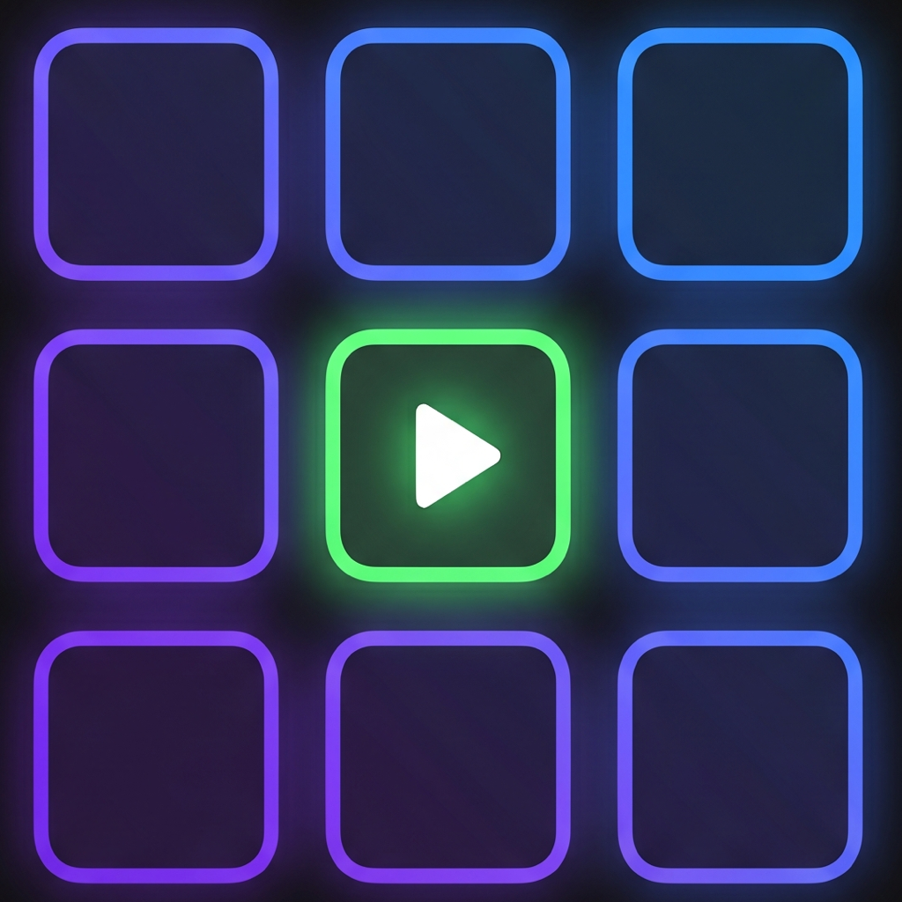

<div align="center">



# MacDeck iOS

**L'app SwiftUI qui transforme ton iPhone ou ton iPad en Stream Deck pour ton Mac.**

<br>


</div>

---

> [!WARNING]
> **Ce dépôt contient la première version de l'app.** La version à jour se trouve dans le dossier [`ios/` du dépôt MacDeck](https://github.com/Andre27aj/MacDeck/tree/master/ios). Elle ajoute le **jumelage par code**, les **boutons URL** et les sections **Base / En cours**.
>
> Le serveur MacDeck actuel exige un token de jumelage, que cette version n'envoie pas : **utilise `MacDeck/ios`** pour une installation neuve.

## 🧩 L'écosystème

| Dépôt | Contenu | Pour |
|---|---|---|
| [MacDeck](https://github.com/Andre27aj/MacDeck) | Serveur Mac, PWA et **app iOS à jour** (`ios/`) | macOS + tous les clients |
| **MacDeck-iOS** *(ici)* | Première version de l'app iOS | iPhone / iPad |
| [MacDeck-Windows](https://github.com/Andre27aj/MacDeck-Windows) | Serveur équivalent pour PC | Windows 10/11 |

## ✨ Fonctionnalités

| | |
|---|---|
| 📡 **Découverte automatique** | Trouve le Mac via Bonjour, sans saisir d'IP |
| 🎚️ **Volume et luminosité** | Sliders verticaux tactiles |
| 🔇 **Mute** | Son et micro séparément, avec retour visuel |
| ⏯️ **Médias** | Lecture/pause, suivant/précédent, titre et artiste en cours |
| 🚀 **Grille d'apps** | Lance n'importe quelle app en un tap ; contour vert si elle est déjà ouverte |
| ⚙️ **Page Système** | Verrouiller, veille écran, capture, mode sombre, Mission Control, Ne pas déranger, veille, corbeille, Spotlight, Cmd+Tab, Cmd+Q |
| 🧠 **Profils automatiques** | Les raccourcis s'adaptent à l'app active (Figma, Xcode, Safari) |
| 🔋 **Batterie du Mac** | Affichée en temps réel |
| 📳 **Retour haptique** | Une vibration à chaque action |
| 📐 **Portrait et paysage** | Mise en page adaptée à l'iPhone et à l'iPad |

## 🚀 Installation

**Côté Mac :** lance le serveur [MacDeck](https://github.com/Andre27aj/MacDeck) (`npm install && npm start`).

**Côté iPhone / iPad :**

```bash
git clone https://github.com/Andre27aj/MacDeck-iOS.git
cd MacDeck-iOS
brew install xcodegen
xcodegen generate
open MacDeck.xcodeproj
```

1. Branche ton iPhone ou ton iPad et sélectionne-le comme destination.
2. Dans *Signing & Capabilities*, choisis ton **Team**. Un compte Apple gratuit suffit pour installer sur tes propres appareils.
3. Lance avec **⌘R**.

Si Bonjour ne trouve pas le Mac (réseaux séparés, VPN…), touche ⚙️ et entre son IP à la main.

## 🎛️ Utilisation

- **Changer de page** : balaie vers la gauche ou la droite, ou touche les onglets **Apps** / **Système**.
- **Personnaliser la grille** (✏️) : nom affiché, nom exact de l'app macOS (`Figma`, `Google Chrome`…) et icône SF Symbol de secours.

## 🏗️ Comment ça marche

```
iPhone / iPad (SwiftUI)  ── HTTP ──▶  Mac (serveur Node.js, port 3000)  ── osascript / pmset ──▶  macOS
```

L'app interroge `/system/status` toutes les 5 secondes pour rester synchronisée. Chaque bouton envoie une requête `POST`.

## 🗂️ Structure

```
MacDeck-iOS/
├── project.yml               # Spec XcodeGen (génère le .xcodeproj)
└── MacDeck/
    ├── MacDeckApp.swift      # Point d'entrée
    ├── ContentView.swift     # Mise en page, orientation
    ├── LeftPanel.swift       # Volume, luminosité, médias
    ├── MutePanel.swift       # Mute son / micro
    ├── DeckGrid.swift        # Grille d'apps
    ├── PagedDeckView.swift   # Onglets Apps / Système + swipe
    ├── SystemPage.swift      # Actions système
    ├── AppEditorView.swift   # Éditeur de la grille
    ├── AppProfiles.swift     # Profils par app
    ├── AppProfilePage.swift  # Raccourcis du profil actif
    ├── ViewModel.swift       # État global
    ├── APIClient.swift       # Client HTTP + modèles
    └── ServiceDiscovery.swift# Bonjour / mDNS
```

## ⚠️ Limitations

- L'iPhone et le Mac doivent être sur le **même réseau local**.
- L'app s'installe via Xcode : elle n'est pas sur l'App Store.

## 📄 Licence

MIT, voir [LICENSE](LICENSE).
